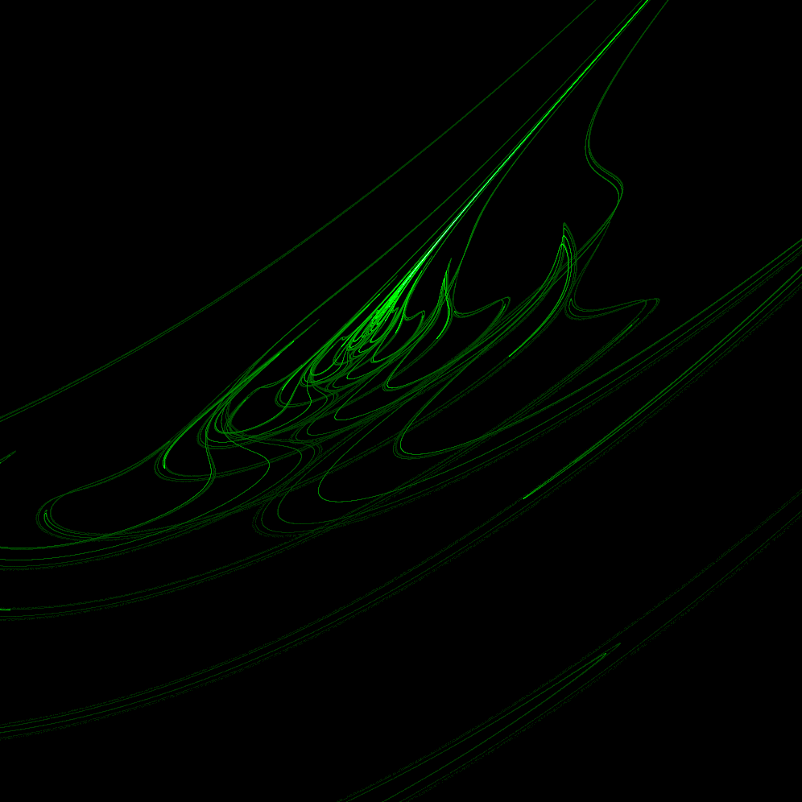
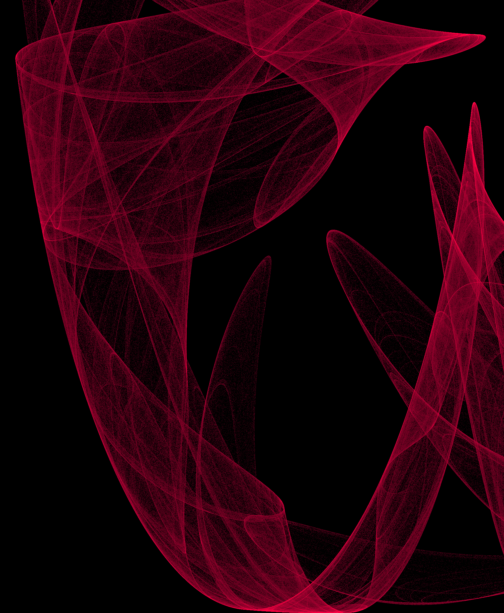
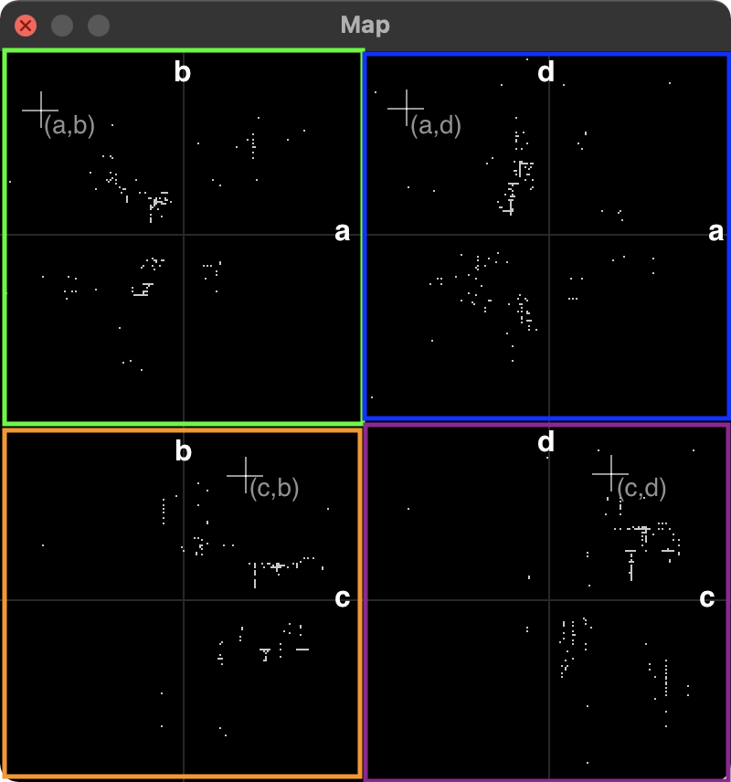

# Attractors

A [Rust](https://www.rust-lang.org/) project to generate and explore [strange
attractors](https://en.wikipedia.org/wiki/Attractor#Strange_attractor) visually
and easily. The emphasis is on using strange attractors as an artistic medium,
and not explicitly on the maths behind them (although the maths is
unavoidable).

See below for example images of strange attractors to give you a feel for what
they look like. After that is some info about getting started with the project
and running the code to find your own. Following that is some more background
info about strange attractors and the different types.

## Examples of strange attractors

See more images in the [`imgs`](https://github.com/beyarkay/attractors/tree/main/img)
directory. They're all very high resolution (about 7000 pixels on each side) so
you can print them out at An size at 300 DPI.




## Get started and making your own strange attractors

Install the rust compiler and cargo by following the instructions at [install
rust](https://www.rust-lang.org/tools/install) or by running the command:

```sh
curl --proto '=https' --tlsv1.2 -sSf https://sh.rustup.rs | sh
```

Then clone this project:

```sh
git clone https://github.com/beyarkay/attractors.git
```

Change directory and run the project in `--release` mode:

```sh
cd attractors && cargo run --release
```

The extra optimisations given by the `--release` flag are _really_ required for
a smooth experience.

Two windows open: the attractor itself, and a square Map window to its left.
The terminal lists every key; press `?` in the attractor window to list them
again. The attractor window's title shows the current parameters, palette and
step size.

Click the attractor window to focus it, then change the parameters with the two
rows of keys under your right hand. The keys act on a window of four parameters
at a time, which for a Clifford attractor is all of a, b, c and d:

```
u i o p    increase the 1st, 2nd, 3rd, 4th parameter in the window
j k l ;    decrease the 1st, 2nd, 3rd, 4th parameter in the window
[ / ]      slide the window left / right, for attractors with more than four
t / T      multiply / divide the step size by 10
```

Hold a key to keep changing a parameter.

### Kinds of attractor

Press `a` / `A` to switch to the next / previous kind of attractor, or start
with one directly:

```sh
cargo run --release -- --attractor tinkerbell
```

The kinds are `clifford`, `dejong`, `kingsdream`, `henon` (2 parameters),
`tinkerbell` and `sprott` (Sprott's quadratic map, 12 parameters). Each kind
keeps its saved images and special attractors in its own `cache/<name>/`
directory.

To add a new kind, write a struct holding its parameters in
`src/attractors.rs`, implement the `Attractor` trait for it (its name,
parameter names, default parameters, a range for the map, and the formula), and
add it to the list in `all_attractors!` in `src/lib.rs`. If you don't know a box that contains the
attractor, leave out `bounds` and it will be estimated from a sample of points.

### Colours

| Key       | Effect                                                    |
| --------- | --------------------------------------------------------- |
| `c` / `C` | next / previous palette                                   |
| `d` / `D` | more / less contrast (higher darkens the faint areas)     |
| `n` / `N` | blend frames together less / more                         |

The palettes are Inferno, Aurora, Ice, Gold, Neon, Magma, Cubehelix, Turbo, and
two light-background ones for printing on paper, Ink and Terracotta.

The preview is coloured so that it looks like the saved image shrunk down to
the window's size, so what you see is what you'll print. Blending frames
together (`N`) makes changes fade in like echoes, which reduces flashing and is
gentler for people with photosensitive epilepsy.

### The Map window

If you look at the Map window, you'll see four 2D plots. Each of the four plots
shows two of the parameters in the current window, and together they can guide
you around the parameter space. Click and drag on a plot to set its two
parameters. Attractors with fewer than four parameters show fewer plots. For a
Clifford attractor the plots are oriented like this:

```
       b            b
       |            |
  -----+----a  -----+----c
       |            |
       |            |

       d            d
       |            |
  -----+----a  -----+----c
       |            |
       |            |
```

And the window looks like this:



As you change parameters, the white cross-hair on each plot moves to show the
current values of that plot's two parameters.

The dots on the map, like constellations, are special attractors. A dot glows
amber as the parameters the plot doesn't show get close to that attractor's,
and turns green once you're right on it. Press `m` to mark the current
attractor as special. Special attractors are saved to
`cache/<name>/special.txt` and persist between runs.

### Other commands

| Key       | Effect                                                        |
| --------- | ------------------------------------------------------------- |
| `r`       | jump to a random special attractor                            |
| `R`       | random parameters, retried until the attractor is chaotic     |
| `s` / `S` | save an A3 / A0 png at 600 DPI into `cache/<name>/`           |
| `z` / `Z` | zoom in / out                                                 |
| `x`       | reset zoom and pan                                            |
| `y`       | run more simulation steps for a smoother preview              |
| `m`       | mark the current attractor as special                         |
| `Esc`     | quit                                                          |

You can also save every attractor in a file of parameter lines like
`a=..,b=..,c=..,d=..` without opening a window:

```sh
cargo run --release -- cache/clifford/special.txt A3
cargo run --release -- --attractor henon henon_params.txt A3
```

## What are Strange Attractors

Strange attractors are (usually) a recursive formula which take in a point in
2D or 3D space and (using a set of parameters) return a different point in that
space. An example equation might be:

```
x_new = sin(a * y_old) + c * cos(a * x_old)
y_new = sin(b * x_old) + d * cos(b * y_old)
```

That new point is then sent back into the same recursive formula to generate
another point. And another, and another, etc. Those points are then coerced
into a pixel grid, and the resulting 2D or 3D histogram sometimes looks
spectacular.

See these links for examples of strange attractors.

- [Clifford Attractors](http://paulbourke.net/fractals/clifford/)
- [De Jong Attractors](http://paulbourke.net/fractals/peterdejong/)
- [Lyapunov Exponent Attractors](http://paulbourke.net/fractals/lyapunov/)
- [Sprott Polynomial Attractors](http://paulbourke.net/fractals/sprott/)
- [Juan Attractors](http://paulbourke.net/fractals/juan2/)
- [Den Tsucs Attractors](http://paulbourke.net/fractals/tsucs/)
- [Sánchez 'Bad Hairday' Attractors](http://paulbourke.net/fractals/2dmap/), also see
  [here](https://www.r-bloggers.com/2019/10/strange-attractors-an-r-experiment-about-maths-recursivity-and-creative-coding/)
- [Arneodo Attractors](http://paulbourke.net/fractals/arneodo/)
- [Catrián Attractors](http://paulbourke.net/fractals/JuanCatrian/)
- [Burke-Shaw Attractors](http://paulbourke.net/fractals/burkeshaw/)
- [Yu-Wang Attractors](http://paulbourke.net/fractals/yuwang/)
- [Tinkerbell Attractor](https://en.wikipedia.org/wiki/Tinkerbell_map)
- [The King's Dream Attractors](https://nathanselikoff.com/training/tutorial-strange-attractors-in-c-and-opengl)
  - `float xnew = sin(y*b) + c*sin(x*b); float ynew = sin(x*a) + d*sin(y*a);`
- [Others defined on wikipedia/chaotic_maps](https://en.wikipedia.org/wiki/List_of_chaotic_maps)
- [Others defined on Chaoscope](http://www.chaoscope.org/doc/attractors.htm)

## TODO

- Add Diagnostics: fractal dimension greater than 1.5 => Chaotic?
- Add Diagnostics: positive Lyapunov exponent => Chaotic
- Add a way to create videos
- Add a way to line up parameter changes with timestamps so that the moving
  attractors will 'react' in time with the music
- Use crate `meval` to auto-parse maths formulas for new attractors
- Add in commands to pan and zoom the display window
- Add in better colour palettes (maybe https://crates.io/crates/palette,
  https://crates.io/crates/color-art, or https://crates.io/crates/colorous?)
